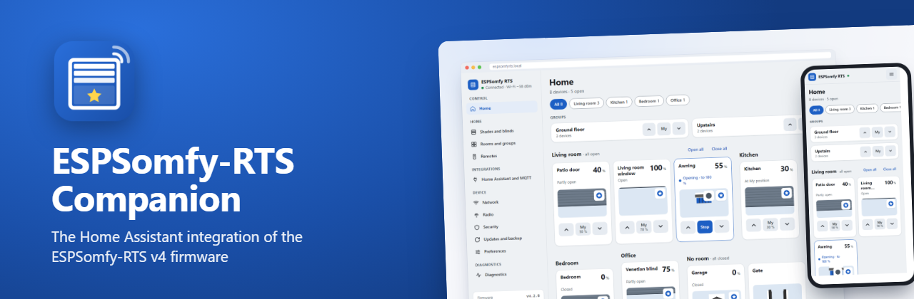

  

**[Version française](README_fr.md)** · [Services](docs/Services.md) · [Report an issue](https://github.com/Pulpyyyy/ESPSomfy-RTS-companion/issues)

**ESPSomfy-RTS Companion** brings your Somfy RTS shades, blinds, awnings, gates and garage doors into Home Assistant, through an ESP32 board running the **[ESPSomfy-RTS v4 firmware](https://github.com/Pulpyyyy/ESPSomfy-RTS)**. It finds the board on its own, follows every move, including those made with your remotes, and installs firmware updates from Home Assistant.

## Start with the firmware

The integration talks to an ESP32 and a CC1101 radio module running **ESPSomfy-RTS v4**:

* **[Install it from your browser](https://pulpyyyy.github.io/ESPSomfy-RTS/)** (Chrome or Edge, USB cable), or with the files of the [latest release](https://github.com/Pulpyyyy/ESPSomfy-RTS/releases).
* **Every order gets through**: orders are queued, sent as one continuous train like a remote button press, and the board listens before it transmits.
* **Updates from GitHub in one click**, installed at boot, with an automatic return to the previous version if a new one does not start.
* **A modern interface** for phones and computers: Home page by room, position panel, guided calibration with your remote, RF diagnostics.
* **Secured**: PIN code or password, for the whole board or for its configuration only.

The [firmware wiki](https://github.com/Pulpyyyy/ESPSomfy-RTS/wiki) covers the hardware, the first start and every setting, in English and French.

## Installation

### From the Marketplace (Home Assistant 2026.11 or later)

Click the button above, or go to **Settings › Marketplace › Add from link** and enter `https://github.com/Pulpyyyy/ESPSomfy-RTS-companion`, then install **ESPSomfy-RTS Companion** and restart Home Assistant.

### With HACS (older versions of Home Assistant)

**HACS › Integrations › ⋮ › Custom repositories**, add `https://github.com/Pulpyyyy/ESPSomfy-RTS-companion` with the **Integration** category, install it, then restart Home Assistant.

### By hand

Copy `custom_components/espsomfy_rts_companion/` into the `config/custom_components/` folder of Home Assistant, then restart it.

### First setup

Home Assistant finds the board on its own (UPnP or mDNS): it shows up in **Settings › Devices & services**, ready to be added. Enter the PIN code or password if the board has one. If Home Assistant sits on another network segment, add the integration by hand with the address of the board.

## Coming from ESPSomfy-RTS Enhanced

ESPSomfy-RTS Companion is the new name of the integration published here as *ESPSomfy-RTS Enhanced* up to v3.5.0. The Home Assistant domain changed, so Home Assistant sees it as a new integration:

1. Note the automations, scripts and dashboards that use your shades.
2. Remove the *ESPSomfy-RTS Enhanced* integration in **Settings › Devices & services**, then remove it from HACS or the Marketplace.
3. Install **ESPSomfy-RTS Companion** as above and add your board.
4. Check your entity ids (rename them back if needed) and replace the `espsomfy_rts_enhanced.*` actions with `espsomfy_rts_companion.*`. The `espsomfy-rts_event` events keep their name.

## Features

* **Full control**: open, close, stop and set positions in percent, tilt included, for shades and groups.
* **Always in sync**: positions follow the board in real time, whether the order came from Home Assistant, a remote or the board's own interface.
* **Firmware updates**: an `update` entity shows when a new ESPSomfy-RTS release is out and installs it from Home Assistant.
* **Automations**: shades are standard `cover` entities, and the integration adds actions for steps, raw RTS commands, position correction without moving, sun and wind flags, restart and backup (see [Services](docs/Services.md)).
* **Device health**: a *Connectivity* diagnostic sensor per board is `on` while the websocket is connected and the HTTP API answers (checked every minute).
* **Backups**: the *Backup* button (or the `espsomfy_rts_companion.backup` action) stores the board configuration on the Home Assistant host. A failed backup raises an error visible in automation traces, the *Last backup* sensor shows when the newest one was taken, and the number of backups kept (5 by default, 1 to 50) is set in the integration options.

## Events

Every command the board sees (from Home Assistant, a physical remote or its web interface) is sent on the Home Assistant event bus as an `espsomfy-rts_event` event.

| Key | Description |
| :--- | :--- |
| `entity_id` | The target entity in Home Assistant (e.g. `cover.living_room_shade`). |
| `event_key` | The event trigger (currently always `shadeCommand`). |
| `name` | The name of the device. |
| `remote_address` | The radio address of the motor in ESPSomfy-RTS. |
| `source_address` | The address of the source (remote channel or group). |

`source` says where the command came from: `remote` (a physical remote), `internal` (the board's interface) or `group` (a group command). `command` is the action: `Up`, `Down`, `My`, `StepUp`, `StepDown`, `Prog`, or a key combination (`My+Up`, `My+Down`, `Up+Down`, `My+Up+Down`).

## Credits

This integration started from xkain's [ESPSomfy-RTS Enhanced](https://github.com/xkain/ESPSomfy-RTS-enhanced), itself based on rstrouse's [ESPSomfy-RTS-HA](https://github.com/rstrouse/ESPSomfy-RTS-HA).
