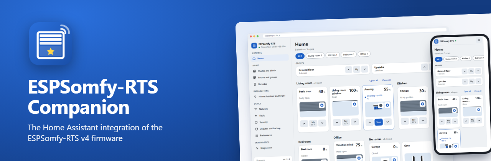

  

**[English version](README.md)** · [Services](docs/Services.md) · [Signaler un problème](https://github.com/Pulpyyyy/ESPSomfy-RTS-companion/issues)

**ESPSomfy-RTS Companion** fait entrer vos volets, stores, bannes, portails et portes de garage Somfy RTS dans Home Assistant, grâce à une carte ESP32 qui fait tourner le **[firmware ESPSomfy-RTS v4](https://github.com/Pulpyyyy/ESPSomfy-RTS)**. Elle trouve la carte toute seule, suit chaque mouvement, y compris ceux faits avec vos télécommandes, et installe les mises à jour du firmware depuis Home Assistant.

## Commencez par le firmware

L'intégration dialogue avec une ESP32 et un module radio CC1101 équipés d'**ESPSomfy-RTS v4** :

* **[Installez-le depuis votre navigateur](https://pulpyyyy.github.io/ESPSomfy-RTS/)** (Chrome ou Edge, câble USB), ou avec les fichiers de la [dernière version](https://github.com/Pulpyyyy/ESPSomfy-RTS/releases).
* **Chaque ordre passe** : les ordres sont mis en file, partent en un seul train continu comme un appui sur une télécommande, et la carte écoute avant d'émettre.
* **Mises à jour depuis GitHub en un clic**, installées au démarrage, avec retour automatique à la version précédente si la nouvelle ne démarre pas.
* **Une interface moderne** pour téléphone et ordinateur : accueil par pièce, panneau de position, calibrage guidé avec votre télécommande, diagnostic radio.
* **Sécurisé** : code PIN ou mot de passe, pour toute la carte ou pour sa configuration seulement.

Le [wiki du firmware](https://github.com/Pulpyyyy/ESPSomfy-RTS/wiki) détaille le matériel, la mise en route et chaque réglage, en français et en anglais.

## Installation

### Depuis le Marketplace (Home Assistant 2026.11 ou plus récent)

Cliquez sur le bouton ci-dessus, ou allez dans **Paramètres › Marketplace › Ajouter depuis un lien** et saisissez `https://github.com/Pulpyyyy/ESPSomfy-RTS-companion`, puis installez **ESPSomfy-RTS Companion** et redémarrez Home Assistant.

### Avec HACS (versions plus anciennes de Home Assistant)

**HACS › Intégrations › ⋮ › Dépôts personnalisés**, ajoutez `https://github.com/Pulpyyyy/ESPSomfy-RTS-companion` dans la catégorie **Intégration**, installez-la, puis redémarrez Home Assistant.

### À la main

Copiez `custom_components/espsomfy_rts_companion/` dans le dossier `config/custom_components/` de Home Assistant, puis redémarrez-le.

### Premier réglage

Home Assistant trouve la carte tout seul (UPnP ou mDNS) : elle apparaît dans **Paramètres › Appareils et services**, prête à être ajoutée. Saisissez le code PIN ou le mot de passe si la carte en a un. Si Home Assistant est sur un autre segment de réseau, ajoutez l'intégration à la main avec l'adresse de la carte.

## Vous venez d'ESPSomfy-RTS Enhanced

ESPSomfy-RTS Companion est le nouveau nom de l'intégration publiée ici sous le nom *ESPSomfy-RTS Enhanced* jusqu'à la v3.5.0. Le domaine Home Assistant a changé : Home Assistant la voit donc comme une nouvelle intégration.

1. Notez les automatisations, scripts et tableaux de bord qui utilisent vos volets.
2. Supprimez l'intégration *ESPSomfy-RTS Enhanced* dans **Paramètres › Appareils et services**, puis retirez-la de HACS ou du Marketplace.
3. Installez **ESPSomfy-RTS Companion** comme ci-dessus et ajoutez votre carte.
4. Vérifiez les identifiants de vos entités (renommez-les si besoin) et remplacez les actions `espsomfy_rts_enhanced.*` par `espsomfy_rts_companion.*`. Les événements `espsomfy-rts_event` gardent leur nom.

## Fonctionnalités

* **Contrôle complet** : ouvrir, fermer, arrêter et régler une position en pourcentage, inclinaison comprise, pour les volets et les groupes.
* **Toujours synchronisée** : les positions suivent la carte en temps réel, que l'ordre vienne de Home Assistant, d'une télécommande ou de l'interface de la carte.
* **La carte en un clic** : la carte, chaque volet et chaque groupe renvoient à la page correspondante de l'interface web de la carte (**Visiter** sur la page de l'appareil).
* **Mises à jour du firmware** : une entité `update` signale chaque nouvelle version d'ESPSomfy-RTS et l'installe depuis Home Assistant.
* **Automatisations** : les volets sont des entités `cover` standard, et l'intégration ajoute des actions pour les pas, les commandes RTS brutes, la correction de position sans mouvement, les drapeaux soleil et vent, le redémarrage et la sauvegarde (voir [Services](docs/Services.md)).
* **État de la carte** : un capteur de diagnostic *Connectivité* par carte est `on` tant que le websocket est connecté et que l'API HTTP répond (vérifié chaque minute).
* **Sauvegardes** : le bouton *Sauvegarde* (ou l'action `espsomfy_rts_companion.backup`) enregistre la configuration de la carte sur l'hôte Home Assistant. Un échec lève une erreur visible dans les traces d'automatisation, le capteur *Dernière sauvegarde* indique la plus récente, et le nombre de sauvegardes conservées (5 par défaut, de 1 à 50) se règle dans les options de l'intégration.

## Événements

Chaque commande vue par la carte (depuis Home Assistant, une télécommande physique ou son interface web) est envoyée sur le bus d'événements de Home Assistant sous la forme d'un événement `espsomfy-rts_event`.

| Clé | Description |
| :--- | :--- |
| `entity_id` | L'entité ciblée dans Home Assistant (par ex. `cover.volet_salon`). |
| `event_key` | Le déclencheur (actuellement toujours `shadeCommand`). |
| `name` | Le nom de l'équipement. |
| `remote_address` | L'adresse radio du moteur dans ESPSomfy-RTS. |
| `source_address` | L'adresse de la source (canal de télécommande ou groupe). |

`source` indique l'origine : `remote` (télécommande physique), `internal` (interface de la carte) ou `group` (commande de groupe). `command` est l'action : `Up`, `Down`, `My`, `StepUp`, `StepDown`, `Prog`, ou une combinaison de touches (`My+Up`, `My+Down`, `Up+Down`, `My+Up+Down`).

## Crédits

Cette intégration est partie d'[ESPSomfy-RTS Enhanced](https://github.com/xkain/ESPSomfy-RTS-enhanced) de xkain, elle-même issue d'[ESPSomfy-RTS-HA](https://github.com/rstrouse/ESPSomfy-RTS-HA) de rstrouse.
